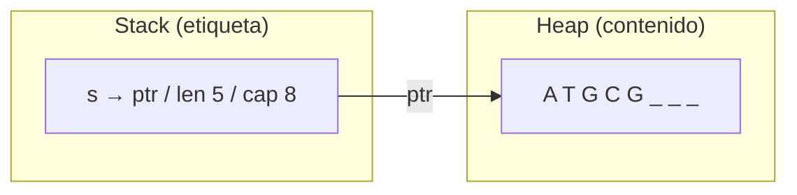

Este es el capítulo que separa a Rust de los demás lenguajes, y también el
que concentra su fama de "difícil". La buena noticia: el concepto —llamado
*ownership* o posesión— es corto de enunciar, y una vez que lo interiorizas,
los errores que hoy parecen crípticos se vuelven mensajes lógicos. La mejor
estrategia es leer con calma, ejecutar los ejemplos y equivocarse a propósito:
el compilador es el laboratorio de este capítulo.

## 4.1 El problema que Rust resuelve

Toda variable de tu programa vive en la memoria del computador, y alguien
tiene que administrar esa memoria. Históricamente hay dos enfoques. En C y
C++, el programador pide y libera la memoria a mano: máximo rendimiento,
pero un error de descuido (usar memoria ya liberada, olvidar liberarla,
escribir fuera de tu zona) corrompe datos silenciosamente. En Python, R y
Java, un *recolector de basura* la administra en tiempo de ejecución: seguro
y cómodo, pero con un costo en velocidad y en previsibilidad.

Rust eligió un tercer camino: las reglas de administración de memoria se
verifican **al compilar**, sin costo alguno al ejecutar. El precio es que
tú, programador, debes conocer esas reglas. Para un análisis biológico, el
trato es excelente: un programa que compila no corrompe memoria, y esa
garantía vale oro cuando el resultado alimenta una publicación.

## 4.2 Las tres reglas de la posesión

El sistema completo se apoya en tres reglas:

1. Cada valor tiene exactamente un **dueño** (la variable que lo contiene).
2. Solo puede haber un dueño a la vez: cuando asignas o pasas un valor, la
   propiedad se **transfiere** (*move*).
3. Cuando el dueño llega al final de su ámbito (`}`), el valor se destruye
   y su memoria se libera automáticamente.

La destrucción automática al salir del ámbito es inmediata y predecible:

```rust
fn main() {
    {
        let temporal = String::from("resultados temporales");
        println!("Dentro del ámbito: {}", temporal);
    } // `temporal` se destruye aquí, sin que nadie lo pida

    // println!("{}", temporal); // ⛔ NO COMPILA (intencionalmente)
}
// Dentro del ámbito: resultados temporales
```

No hay que liberar nada a mano ni esperar a que el recolector pase: la llave
de cierre hace el trabajo. La línea comentada falla porque, al salir del
ámbito, `temporal` ya no existe.

## 4.3 Stack y heap: el congelador del laboratorio

Para entender las reglas hace falta una imagen mental de la memoria. La
memoria se organiza en dos regiones. El **stack** (pila) es una pila de
bandejas: rápida, ordenada, y cada bandeja tiene un tamaño fijo conocido en
compilación; ahí viven los enteros, flotantes, booleanes y `char`. El
**heap** (montículo) es el congelador del laboratorio: un espacio grande y
desordenado donde guardas cajas de cualquier tamaño, a cambio de anotar en
una etiqueta dónde quedó cada una. Un `String` es exactamente eso: en el
stack guarda una etiqueta con tres datos (puntero al heap, longitud,
capacidad), y el texto real vive en el heap.



Esta arquitectura explica las reglas. Copiar la etiqueta (stack) es barato;
copiar el contenido (heap) puede ser caro —imagina un genoma de 3 mil
millones de bases—. Y dos etiquetas apuntando a la misma caja del congelador
son un peligro: cuando la primera se destruya y "devuelva" la caja, la
segunda quedaría apuntando a memoria ajena. La solución de Rust: cuando
copias la etiqueta, la original se anula. Eso es exactamente un *move*.

## 4.4 Move: la transferencia de propiedad

Asignar un `String` a otra variable no copia el contenido: **transfiere** la
propiedad, y la variable original queda invalidada:

```rust
fn main() {
    let s1 = String::from("ATGC");
    let s2 = s1;              // la propiedad se mueve de s1 a s2
    println!("{}", s1);       // ⛔ NO COMPILA (intencionalmente)
}
```

El mensaje de error que verás es el famoso `E0382: borrow of moved value:
s1`, con un diagrama que muestra el movimiento y la nota de que el valor se
movió porque tiene un tipo sin `Copy`. La primera vez duele; la décima vez,
tu cerebro ya prevé el problema antes de compilar. Así se entrena la
intuición de memoria que prometimos en el capítulo 1.

Si de verdad necesitas dos copias independientes del contenido, pídelo
explícitamente con `.clone()`:

```rust
fn main() {
    let s1 = String::from("ATGC");
    let s2 = s1.clone();      // copia real del contenido del heap
    println!("{} y {} son independientes", s1, s2);
}
// ATGC y ATGC son independientes
```

Los tipos que viven completos en el stack —enteros, flotantes, `bool`,
`char`, y tuplas o arreglos que solo contengan esos tipos— son **`Copy`**:
se copian por completo al asignarse y jamás se invalidan:

```rust
fn main() {
    let phred = 30u8;
    let copia = phred;        // u8 es Copy: se duplica, nada se mueve
    println!("original {} y copia {}", phred, copia);
}
// original 30 y copia 30
```

::: {.callout-tip}
## Regla de bolsillo
Datos pequeños y de tamaño fijo (números, `char`): se copian, úsalos sin
miedo. Datos que crecen (`String`, y en el capítulo 7 `Vec` y `HashMap`):
asignar mueve; clonar es decisión explícita y tiene costo.
:::

## 4.5 Funciones y propiedad

Pasar una variable a una función sigue las mismas reglas: si la función
recibe el valor por propiedad, el parámetro se convierte en el nuevo dueño y
la variable original queda inservible:

```rust
fn reportar(secuencia: String) {
    println!("Analizando {} pb", secuencia.len());
} // `secuencia` se destruye aquí, junto con su contenido

fn main() {
    let dna = String::from("ATGGCCTTTTAA");
    reportar(dna);            // la propiedad viaja a la función
    println!("{}", dna);      // ⛔ NO COMPILA (intencionalmente)
}
```

Podrías devolver el `String` desde la función y recuperarlo (`let dna =
reportar(dna);`), pero ese baile de ida y vuelta es incómodo y nada
ecológico con la memoria. La solución elegante es no transferir nada:
**pedir prestado**.

## 4.6 Referencias: pedir prestado sin quitar

Una **referencia** es un puntero controlado: con `&valor` creas una
referencia que permite usar el valor sin ser su dueño. La función que
recibe `&String` solo lo lee mientras dure la llamada, y el dueño original
conserva su propiedad:

```rust
fn reportar(secuencia: &String) {
    println!("Analizando {} pb", secuencia.len());
}

fn main() {
    let dna = String::from("ATGGCCTTTTAA");
    reportar(&dna);           // prestamos dna, no la regalamos
    println!("{} sigue disponible", dna);
}
// Analizando 12 pb
// ATGGCCTTTTAA sigue disponible
```

Para que la función pueda **modificar** el valor prestado, la referencia
debe ser mutable: `&mut`, y la variable dueña debe declararse `mut`. El
caso biológico típico: normalizar una secuencia que llega en minúsculas:

```rust
fn introducir_mutacion(secuencia: &mut String, base: char) {
    secuencia.push(base);     // agregamos al final
}

fn main() {
    let mut dna = String::from("ATGGCC");
    introducir_mutacion(&mut dna, 'A');
    println!("{}", dna);
}
// ATGGCCA
```

Nótese el doble requisito: `mut` en la variable dueña, `&mut` en el préstamo
y en la llamada. Los tres deben estar de acuerdo.

### Las dos reglas de los préstamos

El prestamista (el compilador, apodado *borrow checker*) aplica dos reglas
en cada instante del programa:

- O bien existe **una** referencia mutable `&mut` al valor,
- o bien existen **todas las que quieras** de solo lectura `&`,
- pero jamás ambas cosas a la vez.

El motivo es evitar carreras de datos: si alguien reescribe la caja del
congelador mientras otro la lee, el lector vería un estado inconsistente.
Veamos las dos situaciones:

```rust
fn main() {
    let dna = String::from("ATGGCCTTTTAA");
    let vista1 = &dna;
    let vista2 = &dna;
    println!("{}\n{}", vista1, vista2);   // ✓ OK: varios lectores
}
```

```rust
fn main() {
    let mut dna = String::from("ATGGCCTTTTAA");
    let lectura = &dna;
    dna.push_str("G");       // ⛔ NO COMPILA (intencionalmente)
    println!("{}", lectura);
}
```

El segundo programa produce `E0502: cannot borrow dna as mutable because it
is also borrowed as immutable`. La cura es de orden, no de fuerza: haz el
`println!` **antes** de mutar, y el préstamo de lectura habrá terminado:

```rust
fn main() {
    let mut dna = String::from("ATGGCCTTTTAA");
    let lectura = &dna;
    println!("{}", lectura);  // el préstamo termina en su último uso
    dna.push_str("G");        // ✓ ahora sí: ya nadie estaba leyendo
    println!("{}", dna);
}
// ATGGCCTTTTAA
// ATGGCCTTTTAAG
```

Rust es suficientemente inteligente para notar cuándo termina el último uso
de un préstamo (la última lectura de `lectura`), así que no necesitas
liberarlo a mano.

## 4.7 Slices: ventanas sobre tus datos

Un **slice** es una referencia a una porción contigua de una colección, sin
copiar nada. Para texto, el tipo slice se escribe `&str` —sí, el mismo tipo
de los literales— y se crea con rangos de índices:

```rust
fn main() {
    let dna = "ATGGCCTTTTAA";

    let primer_codon = &dna[0..3];
    let resto = &dna[3..];
    let todo = &dna[..];

    println!("Codón 1: {} | Resto: {}", primer_codon, resto);
    println!("Todo (slice completo): {}", todo);
}
// Codón 1: ATG | Resto: GCCTTTTAA
// Todo (slice completo): ATGGCCTTTTAA
```

Los rangos usan la misma sintaxis del capítulo 3 (`inicio..fin`, con `..`
para "hasta el final" y `[..]` para todo). Los índices caen sobre **bytes**,
no caracteres: para secuencias ASCII (FASTA en mayúsculas) coinciden
exactamente, pero si el texto tiene caracteres multi-byte el compilador
detiene el programa con un error claro antes de corromper nada.

Los slices son la herramienta natural para recorrer un genoma por ventanas
—codones, k-mers, sitios de restricción— sin duplicar memoria, y la razón
por la que la firma idiomática para texto es `&str`: acepta literales,
slices, y también `String` completos (Rust convierte `&String` a `&str`
automáticamente al pasarla, una comodidad llamada *deref coercion*):

```rust
fn longitud_purinas(seq: &str) -> usize {
    seq.matches('A').count() + seq.matches('G').count()
}

fn main() {
    let literal = "ATGGCC";
    let propia = String::from("ATGGCCUUU"); // ARN en un String

    println!("Literal: {} purinas", longitud_purinas(literal));
    println!("String:  {} purinas", longitud_purinas(&propia));
}
// Literal: 3 purinas
// String:  3 purinas
```

Una sola firma `&str` sirve para ambos mundos. Por eso, en adelante, toda
función del curso que lea texto recibirá `&str`.

## 4.8 ¿Y los lifetimes?

Seguramente ya viste un `'static` en el capítulo 3 y te preguntaste por las
*duraciones* (lifetimes). La idea es simple: cada préstamo tiene un intervalo
de validez, y el compilador verifica que ningún préstamo viva más que su
prestamista —de lo contrario, alguien leería una caja ya devuelta al
congelador. La práctica es aún más simple: en la enorme mayoría de las
funciones, Rust **deduce** las duraciones automáticamente y no escribes nada.
El `'static` de los literales solo dice "este texto vive todo el programa".

En todo este curso escribiremos exactamente cero anotaciones manuales de
duración, y aun así el material intermedio (capítulos 9 a 15) compila sin
problemas. Si algún día el compilador te pida una (`expected lifetime
parameter`), ya sabes qué libro abrir: *The Rust Programming Language*,
capítulo 10.

## 4.9 Guía práctica de firmas

Con posesión, préstamos y slices en la mesa, aquí está la tarjeta de
referencia para diseñar funciones que trabajan con texto biológico:

| Objetivo de la función | Firma recomendada | Qué ocurre |
|------------------------|-------------------|------------|
| Solo leer una secuencia | `fn f(dna: &str)` | préstamo, cero copias |
| Leer y devolver un resultado nuevo | `fn f(dna: &str) -> f64` | el resultado es del llamador |
| Construir una secuencia nueva | `fn f(dna: &str) -> String` | el dueño del retorno se transfiere |
| Modificar la secuencia recibida | `fn f(dna: &mut String)` | préstamo mutable, sin retorno |

::: {.callout-warning}
## Genomas grandes: no clones por reflejo
Un genoma de 3 Gb son 3 GB de heap. Clonarlo "por si acaso" triplica tu
memoria en una línea. Presta (`&`), rebana (`&dna[a..b]`) y devuelve
`String` nuevas solo cuando el dato resultante sea genuinamente distinto.
El borrow checker te empujará, siempre, hacia la opción sin copias.
:::

## Ejercicios

### Ejercicio 4.1 · Arregla el move

El siguiente programa no compila. Explícalo en una frase y arréglalo sin
usar `clone`.

```rust
fn main() {
    let gen = String::from("ATGGCCTTTTAA");
    imprimir(gen);
    println!("El gen {} quedó disponible", gen);
}

fn imprimir(seq: String) {
    println!("Secuencia: {}", seq);
}
```

<details>
<summary>Solución</summary>

El problema: pasar `gen` por valor transfiere la propiedad a `imprimir`, y
al terminar la función la secuencia se destruye, así que el `println!`
posterior usa un valor muerto. El arreglo es prestar en lugar de regalar:

```rust
fn main() {
    let gen = String::from("ATGGCCTTTTAA");
    imprimir(&gen);
    println!("El gen {} quedó disponible", gen);
}

fn imprimir(seq: &str) {
    println!("Secuencia: {}", seq);
}
// Secuencia: ATGGCCTTTTAA
// El gen ATGGCCTTTTAA quedó disponible
```

De paso aplicamos la firma idiomática `&str`: funciona con `&String` gracias
a la coerción de slices.

</details>

### Ejercicio 4.2 · Slices de gen

Escribe `fn primeros(dna: &str, n: usize) -> &str` que devuelva los primeros
`n` caracteres de la secuencia, y pruébala con un literal y con un `String`.
¿Se copia la secuencia en algún momento?

<details>
<summary>Solución</summary>

```rust
fn primeros(dna: &str, n: usize) -> &str {
    &dna[..n]
}

fn main() {
    let literal = "ATGGCCTTTTAA";
    let propia = String::from("GGCCTTTTAA");

    println!("{} | {}", primeros(literal, 3), primeros(&propia, 3));
}
// ATG | GGC
```

No hay copia ninguna: la función devuelve un slice, es decir una vista (puntero + longitud) sobre la memoria original. La duración del retorno está ligada a la del dato de entrada —Rust lo deduce solo— por eso la firma no necesita anotaciones. Ojo: `n` mayor que la longitud entraría en terreno de pánico; una versión robusta usaría `&dna[..n.min(dna.len())]`.

</details>

### Ejercicio 4.3 · Des-enmascarar el genoma

Los genomas *soft-masked* escriben en minúscula las regiones repetitivas:
`atgcccTTTGAA`. Escribe `fn des_enmascarar(seq: &mut String)` que convierta
todo a mayúsculas modificando el mismo `String` (sin devolver nada), usando
`*seq = seq.to_uppercase();`. El `*` "desreferencia": accede al valor
prestado para reemplazarlo.

<details>
<summary>Solución</summary>

```rust
fn des_enmascarar(seq: &mut String) {
    *seq = seq.to_uppercase();
}

fn main() {
    let mut genoma = String::from("atgcccTTTGAA");
    println!("Antes:  {}", genoma);
    des_enmascarar(&mut genoma);
    println!("Después: {}", genoma);
}
// Antes:  atgcccTTTGAA
// Después: ATGCCCTTTGAA
```

La función recibe el préstamo mutable, construye la versión en mayúsculas
(un `String` nuevo y temporal) y reemplaza el contenido de la variable
original; el temporal se destruye al salir. Alternativa sin `*`: un bucle
`for` que recorra `seq.chars()` y acumule en mayúscula, al estilo del
capítulo 3.

</details>

### Ejercicio 4.4 · Caza el conflicto de préstamos

Este programa no compila. Identifica la regla violada y arréglalo cambiando
solo el **orden** de las líneas.

```rust
fn main() {
    let mut cobertura = String::from("30x");
    let informe = &cobertura;
    cobertura.push_str(" (preliminar)");
    println!("Cobertura: {}", informe);
}
```

<details>
<summary>Solución</summary>

Se viola la regla de exclusión mutua: `informe` mantiene un préstamo de
lectura vivo hasta su `println!`, y en medio se pide `&mut` para `push_str`.
Moviendo la lectura antes de la mutación, cada préstamo vive en su momento:

```rust
fn main() {
    let mut cobertura = String::from("30x");
    let informe = &cobertura;
    println!("Cobertura: {}", informe);      // el préstamo termina aquí
    cobertura.push_str(" (preliminar)");
    println!("Actualizada: {}", cobertura);
}
// Cobertura: 30x
// Actualizada: 30x (preliminar)
```

Observa que después de mutar, `cobertura` vuelve a ser perfectamente
legible: lo que se agota es cada préstamo, no la variable.

</details>

### Ejercicio 4.5 · ¿Copy o move?

Sin ejecutar nada, predice si cada fragmento compila. Luego verifica.

```rust
// A
let a = 42;
let b = a;
println!("{} {}", a, b);

// B
let s = String::from("AT");
let t = s;
println!("{} {}", s, t);

// C
let par = (1.5, 2.5);
let copia = par;
println!("{} {}", par.0, copia.0);

// D
let b1 = 'G';
let b2 = b1;
println!("{} {}", b1, b2);
```

<details>
<summary>Solución</summary>

Compilan **A, C y D**; solo **B** falla. `i32` (A), `char` (D) y las tuplas
compuestas íntegramente de tipos `Copy` (C, una tupla de dos `f64`) viven en
el stack y se duplican al asignarse. El `String` (B) tiene contenido en el
heap, así que asignar lo mueve y deja `s` invalidado; para que compile
habría que escribir `let t = s.clone();`.

Este tipo de predicción mental es exactamente el "radar de memoria" que este
capítulo quiere instalarte: tómate 10 segundos antes de cada asignación
grande y pregúntate ¿esto se copia o se mueve?

</details>
