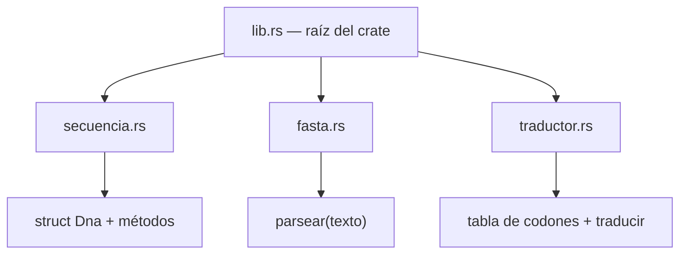

A estas alturas, los programas de ejemplo rondan las 100 o 200 líneas y ya
empiezan a doler en un solo `main.rs`. Este capítulo es la transición de
"scripts" a **proyecto**: dividir el código en módulos con responsabilidades
claras, controlar qué se expone y qué se esconde, y documentar para tu yo
futuro (y para quien use tu herramienta). De regalo: la estructura que
montemos aquí es la base directa del analizador del capítulo 15.

## 11.1 El árbol de módulos

Todo programa Rust tiene una raíz: `main.rs` en un ejecutable, `lib.rs` en
una librería. Los **módulos** cuelgan de esa raíz y pueden anidarse. La
forma más compacta de verlos es declararlos inline:

```rust
mod analisis {
    pub fn contenido_gc(dna: &str) -> f64 {
        let gc = dna.bytes().filter(|b| *b == b'G' || *b == b'C').count();
        gc as f64 / dna.len() as f64 * 100.0
    }
}

fn main() {
    println!("GC: {:.1}%", analisis::contenido_gc("ATGGCCTTTTAA"));
}
// GC: 41.7%
```

El módulo `analisis` agrupa la función, y se accede con la ruta
`analisis::contenido_gc`. En un proyecto real, los módulos viven en sus
propios archivos y forman un árbol:



## 11.2 Privacidad: `pub`

Regla por defecto: **todo lo declarado dentro de un módulo es privado**.
Solo la raíz (`main`/`lib` del crate) y el módulo mismo pueden usarlo. Para
que algo trascienda su módulo, se marca `pub`:

```rust
mod analisis {
    pub fn contenido_gc(dna: &str) -> f64 {
        let gc = dna.bytes().filter(|b| *b == b'G' || *b == b'C').count();
        gc as f64 / dna.len() as f64 * 100.0
    }

    fn redondear(x: f64) -> f64 {
        (x * 10.0).round() / 10.0
    }
}

fn main() {
    println!("GC: {:.1}%", analisis::contenido_gc("ATGGCCTTTTAA"));
    // println!("{:?}", analisis::redondear(41.66)); // ⛔ NO COMPILA
}
// GC: 41.7%
```

`redondear` es un detalle interno: el mundo exterior no puede llamarla, y
esa pared es lo que permite refactorizar el interior de un módulo sin
miedo a romper a nadie. La palabra `pub` va también en structs, campos
(`pub id: String`), enums y sus variantes. En proyectos grandes verás
`pub(crate)`: público dentro del crate, invisible para el exterior — el
punto medio.

## 11.3 Rutas y `use`

Las rutas completas (`crate::analisis::contenido_gc`) funcionan siempre
(`crate::` significa "desde la raíz"), pero escribir todo el camino cansa.
El `use` que ya veníamos usando importa nombres:

```rust
use std::collections::HashMap;      // ruta absoluta de la biblioteca estándar

mod analisis {
    pub fn contenido_gc(dna: &str) -> f64 {
        let gc = dna.bytes().filter(|b| *b == b'G' || *b == b'C').count();
        gc as f64 / dna.len() as f64 * 100.0
    }
}

fn main() {
    use analisis::contenido_gc;             // importar desde tu propio módulo
    println!("GC: {:.1}%", contenido_gc("ATGGCCTTTTAA"));
}
// GC: 41.7%
```

Dos ayudas más: `as` renombora (`use analisis::contenido_gc as gc;` —
útil para nombres largos o repetidos), y `super::` referencia el módulo
padre (desde un submódulo, `super::contenido_gc`). Si prefieres ver rutas
relativas: `self::` es el módulo actual.

## 11.4 Un módulo, un archivo

En proyectos reales, cada módulo migra a su archivo `.rs`. La convención
moderna: en la raíz declaras `mod secuencia;` y el compilador busca
`src/secuencia.rs`:

```text
bio_toolkit/
├── Cargo.toml
└── src/
    ├── main.rs
    ├── lib.rs
    ├── secuencia.rs
    └── fasta.rs
```

El contenido de cada archivo es exactamente lo que iba entre las llaves del
`mod`. Montemos el proyecto completo — **bio_toolkit**, nuestra caja de
herramientas bioinformática creciente:

**`src/lib.rs`** — la raíz de la librería, que solo declara y documenta:

```rust
//! bio_toolkit: herramientas de secuencias para el curso
//! "Rust para biólogos".

pub mod fasta;
pub mod secuencia;
```

**`src/secuencia.rs`** — tipos y análisis de secuencias:

```rust
/// Una secuencia de ADN con identificador.
#[derive(Debug)]
pub struct Dna {
    pub id: String,
    pub bases: String,
}

impl Dna {
    /// Crea una secuencia nueva a partir de datos prestados.
    pub fn nueva(id: &str, bases: &str) -> Dna {
        Dna { id: String::from(id), bases: String::from(bases) }
    }

    /// Longitud en pares de bases.
    pub fn longitud(&self) -> usize {
        self.bases.len()
    }

    /// Contenido de GC en porcentaje.
    pub fn contenido_gc(&self) -> f64 {
        let gc = self.bases.bytes().filter(|b| *b == b'G' || *b == b'C').count();
        gc as f64 / self.bases.len() as f64 * 100.0
    }
}
```

**`src/fasta.rs`** — parseo de texto FASTA (puro: recibe `&str`, no toca
archivos; esa parte llega en el capítulo 12):

```rust
/// Divide un texto FASTA en pares (id, secuencia).
/// El id es lo que sigue a '>' en cada encabezado.
pub fn parsear(texto: &str) -> Vec<(String, String)> {
    let mut registros = Vec::new();
    let mut id_actual = String::new();
    let mut bases = String::new();

    for linea in texto.lines() {
        let linea = linea.trim();
        if linea.is_empty() {
            continue;
        }
        if let Some(encabezado) = linea.strip_prefix('>') {
            if !id_actual.is_empty() {
                registros.push((id_actual, bases));
            }
            id_actual = encabezado.split_whitespace().next().unwrap_or("").to_string();
            bases = String::new();
        } else {
            bases.push_str(linea);
        }
    }
    if !id_actual.is_empty() {
        registros.push((id_actual, bases));
    }
    registros
}
```

**`src/main.rs`** — el ejecutable, que consume la librería:

```rust
use bio_toolkit::fasta::parsear;
use bio_toolkit::secuencia::Dna;

fn main() {
    let fasta_texto = ">genA mini-gen de ejemplo
ATGGCCTTTTAA
>genB fragmento GC alto
GCCGGCCTTAAGGC";

    let registros = parsear(fasta_texto);
    println!("{} registros en el archivo\n", registros.len());

    for (id, bases) in &registros {
        let seq = Dna::nueva(id, bases);
        println!("{}: {} pb, {:.1}% GC", seq.id, seq.longitud(), seq.contenido_gc());
    }
}
```

Ejecutado con `cargo run`:

```text
2 registros en el archivo

genA: 12 pb, 41.7% GC
genB: 14 pb, 71.4% GC
```

Detalles que no deben pasar de largo: el texto FASTA va entre comillas y
usa saltos de línea literales (Rust permite strings multilínea);
`strip_prefix('>')` devuelve `Option` y con `if let` se lee como "si la
línea empieza con >..."; y `split_whitespace().next()` toma solo la
primera palabra del encabezado como id (la descripción completa puede
seguir después).

## 11.5 ¿Por qué `lib.rs` **y** `main.rs`?

Podríamos meter todo en `main.rs` y acabar. La separación librería +
ejecutable tiene dos ventajas científicas. Primera: los **tests** del
capítulo 13 pueden importar `bio_toolkit::fasta::parsear` directamente y
probar la lógica sin ejecutar el programa completo. Segunda: el día que
quieras hacer otra herramienta (un visualizador, un servidor), reutiliza la
librería sin copiar nada. La regla de oro que emerge: **`main.rs` solo
coordina** (leer argumentos, llamar funciones, imprimir); la lógica vive en
módulos. Un `main.rs` de 20 líneas que orquesta módulos de 200 es señal de
salud; el inverso, de deuda.

## 11.6 Documentación ejecutable

Los comentarios `///` antes de un elemento se llaman **doc comments**, y no
son decoración: `cargo doc --open` compila un sitio web con tu API, y los
ejemplos que incluyas en ellos **se compilan y ejecutan como tests**. Mira
el estilo de `secuencia.rs` arriba: cada elemento público lleva su frase.
Un doc comment con ejemplo se ve así:

```rust
/// Devuelve el contenido de GC en porcentaje.
///
/// # Ejemplo
/// ```
/// use bio_toolkit::secuencia::Dna;
/// let s = Dna::nueva("x", "GC");
/// assert_eq!(s.contenido_gc(), 100.0);
/// ```
pub fn contenido_gc(&self) -> f64 {
```

El `//!` que abrió `lib.rs` documenta el módulo completo (nota la
dirección de las barras: `//!` habla del archivo, `///` del elemento
siguiente). La documentación que se compila no se desactualiza: si cambias
la función y olvidas el ejemplo, `cargo test` falla.

## Ejercicios

### Ejercicio 11.1 · Tu primer módulo

Crea el proyecto `bio_toolkit` y agrega el módulo `traductor` (en su propio
archivo `src/traductor.rs`) con las funciones `tabla_codones()` y
`traducir()` del capítulo 7, ambas `pub`. Decláralo en `lib.rs` y úsalo
desde `main.rs` para traducir `ATGGCCTTTTAA`.

<details>
<summary>Solución</summary>

En `src/lib.rs`:

```rust
pub mod traductor;
```

En `src/traductor.rs`:

```rust
use std::collections::HashMap;

/// Tabla de codones (subconjunto; completa en el cap. 7).
pub fn tabla_codones() -> HashMap<&'static str, char> {
    HashMap::from([
        ("ATG", 'M'), ("GCC", 'A'), ("TTT", 'F'),
        ("TAA", '*'), ("TAG", '*'), ("TGA", '*'),
    ])
}

/// Traduce una secuencia de ADN a proteína (marco 0).
pub fn traducir(dna: &str) -> String {
    let tabla = tabla_codones();
    let mut proteina = String::new();
    for i in (0..dna.len()).step_by(3) {
        if i + 3 > dna.len() {
            break;
        }
        let aa = tabla.get(&dna[i..i + 3]).copied().unwrap_or('X');
        proteina.push(aa);
    }
    proteina
}
```

En `src/main.rs`:

```rust
use bio_toolkit::traductor::traducir;

fn main() {
    println!("Proteína: {}", traducir("ATGGCCTTTTAA"));
}
// Proteína: MAF*
```

El `use` importa directamente la función desde el módulo compilado: el
`main` ya no sabe (ni le importa) dónde vive la tabla de codones. Bienvenido
al diseño modular: cada pieza se mueve, se prueba y se documenta por
separado.

</details>

### Ejercicio 11.2 · La pared de la privacidad

Mueve la función `contenido_gc` a un módulo `analisis` **sin** marcarla
`pub`, e intenta llamarla desde `main`. Lee el error completo, explica qué
te dice y corrígelo.

<details>
<summary>Solución</summary>

El error es del estilo:

```text
error[E0603]: function `contenido_gc` is private
 --> src/main.rs:4:38
  |
4 |     println!("{:.1}", analisis::contenido_gc("ATG"));
  |                                      ^^^^^^^^^^^^ function `contenido_gc` is private
```

Aparte de señalar la línea exacta, el error sugiere: "consider marking
`contenido_gc` as `pub`". El compilador interpreta el acceso denegado como
una decisión de diseño que quizá olvidaste publicar — acertó. La corrección
es `pub fn contenido_gc(...)` en el módulo. Lección: la privacidad no es un
estorbo burocrático sino un contrato de superficie pública; cada `pub` que
escribes es una promesa de API que mantendrás.

</details>

### Ejercicio 11.3 · Importaciones con alias

En `main.rs`, importa el módulo `secuencia` con `as seq` y úsalo para crear
dos `Dna` e imprimir un comparativo de longitudes y GC.

<details>
<summary>Solución</summary>

```rust
use bio_toolkit::secuencia as seq;

fn main() {
    let a = seq::Dna::nueva("genA", "ATGGCCTTTTAA");
    let b = seq::Dna::nueva("genB", "GCCGGCCTTAAGGC");

    for s in [&a, &b] {
        println!("{}: {} pb, {:.1}% GC", s.id, s.longitud(), s.contenido_gc());
    }

    let mas_larga = if a.longitud() >= b.longitud() { &a } else { &b };
    println!("Más larga: {}", mas_larga.id);
}
// genA: 12 pb, 41.7% GC
// genB: 14 pb, 71.4% GC
// Más larga: genB
```

`use ... as seq` acorta el prefijo sin cambiar el módulo. El array `[&a,
&b]` presta ambas secuencias para el bucle de reporte. Cuando tu API crezca
(`bio_toolkit::analisis_estadistico::diversidad`), los alias dejarán de ser
capricho y serán higiene.

</details>

### Ejercicio 11.4 · Parsea un FASTA multilínea

Agrega a `fasta.rs` la función `pub fn cantidad_registros(texto: &str)
-> usize` y prueba `parsear` con un FASTA cuya secuencia esté partida en
dos líneas, verificando que las líneas se unen.

<details>
<summary>Solución</summary>

```rust
pub fn cantidad_registros(texto: &str) -> usize {
    parsear(texto).len()
}
```

Y la prueba en `main.rs`:

```rust
use bio_toolkit::fasta::{parsear, cantidad_registros};

fn main() {
    let fasta = ">genA dividido en dos líneas
ATGGCC
TTTTAA";

    println!("Registros: {}", cantidad_registros(fasta));
    for (id, bases) in parsear(fasta) {
        println!("{} -> {} pb: {}", id, bases.len(), bases);
    }
}
// Registros: 1
// genA -> 12 pb: ATGGCCTTTTAA
```

La clave del comportamiento está en `parsear`: las líneas de secuencia se
concatenan con `push_str` hasta que aparece el siguiente `>` (o el final),
así que un genoma real partido en 60 columnas de texto se reensambla solo.
Ese es exactamente el formato en que los archivos FASTA llegan del mundo
real — y en el capítulo 12 lo leeremos directo desde disco.

</details>

### Ejercicio 11.5 · Documenta y genera tu sitio

Agrega doc comments `///` a `Dna::nueva`, `Dna::longitud` y
`fasta::parsear`, incluyendo en `contenido_gc` un bloque de ejemplo como el
del capítulo. Ejecuta `cargo doc --open` y navega tu API; luego `cargo
test` y observa que tu ejemplo se ejecutó como test.

<details>
<summary>Solución</summary>

Doc comments de ejemplo para `secuencia.rs`:

```rust
/// Crea una secuencia nueva a partir de datos prestados.
///
/// # Ejemplo
/// ```
/// use bio_toolkit::secuencia::Dna;
/// let s = Dna::nueva("genA", "ATG");
/// assert_eq!(s.longitud(), 3);
/// ```
pub fn nueva(id: &str, bases: &str) -> Dna {
    Dna { id: String::from(id), bases: String::from(bases) }
}
```

Tras `cargo doc --open`, el navegador muestra el sitio generado con tu
módulo, sus funciones y los ejemplos renderizados como bloques de código.
Tras `cargo test`, entre los resultados aparece la línea `Doc-tests
bio_toolkit` con tu ejemplo contado como test: documentación que se
verifica sola. Los grandes crates del ecosistema (incluido el `bio` que
conocerás en el capítulo 14) se documentan exactamente así.

</details>
